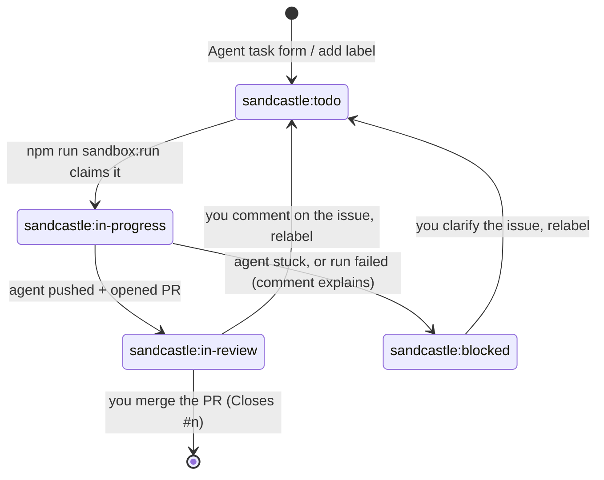

# imigraph

Imitating systems with graphs: computational physics and graph-based models in Python
(numpy, scipy, networkx), with a browser GUI running the same Python code in WebAssembly
(Pyodide/PyScript).

## What is here

The first experiment: Brownian motion in a 2D box (the reference) imitated by walker nodes
hopping on a lattice graph with an edge-rewriting rule, and a comparison framework that decides
whether the imitation holds. Read [docs/requirements.md](docs/requirements.md) for the goals,
[docs/architecture.md](docs/architecture.md) for the code layout and
[docs/comparison-method.md](docs/comparison-method.md) for how the comparison works and how it
is validated. Plans per issue live in [plans/](plans/).

The second experiment: an energy-conserving hard-disk gas (the reference) next to a lattice gas
on the same walker graph, whose rules (Collide, Reflect, Stream, the HPP model as edge
rewrites) conserve mass, momentum and energy exactly and make walkers collide.

```bash
docker compose run --rm dev uv run python -m imigraph report       # writes output/brownian_vs_graph_<time>.html
docker compose run --rm dev uv run python -m imigraph gas-report   # writes output/gas_<time>.html
docker compose up web                                               # live GUI at http://localhost:8000
```

Every run writes a new timestamped page and keeps the older ones; `output/index.html` lists
them, newest first. Open the newest one in a browser: animations of the reference, of the graph
step by step and of the projection, the comparison plots and verdict, and a "questions and
answers" card about the graph model (what kind of graph, node types, how energy, momentum and
entropy are computed, what happens when particles collide). The GUI runs the same Python
package in the browser (Pyodide): a *playground* with a small world (size, walkers, playback
speed) and an editable rule (notation, direction weights, self-loops; presets; export and import
as JSON; `python -m imigraph report --rule '<json>'` runs an exported rule), and the comparison
run with parameters of your choice, including the edited rule. Published pages:
[imigraph-reports](https://github.com/molntamas/imigraph-reports).

## Development in Docker (nothing installed on the host)

All tooling lives in the image sandcastle uses (`sandcastle:imigraph`); `compose.yaml` runs it
with the repository bind-mounted:

```bash
docker compose build dev                                        # once, or after .sandcastle/Dockerfile changes
docker compose run --rm dev uv run pytest                       # tests
docker compose run --rm dev uv run ruff check .                 # lint
docker compose run --rm dev uv run ty check                     # type check
docker compose run --rm dev pre-commit run --all-files          # secret scan + lint + format
docker compose run --rm dev bash -c 'git add -A && git commit -m "..."'   # commit with hooks
docker compose run --rm dev                                     # interactive shell
docker compose --profile verify run --rm verify                 # headless browser check of the pages
docker compose run --rm dev uv run python docker/check-pages.py --serve   # the same check, no second container
```

The image ships headless Chromium (playwright is a dev dependency), so the page check also
works inside sandcastle sessions, which have no Docker: `uv run python docker/check-pages.py
--serve`. Details and pitfalls (git hooks, line endings, verifying pages) are in the
`docker-dev` skill.

### Without Docker

```bash
uv sync                                               # Python 3.14 + dependencies into .venv
uv run pytest
uv run ruff check . && uv run ruff format --check .
uv run ty check
pre-commit install                                    # once per clone: secret scan + lint on commit
```

Conventions for humans and agents: [CLAUDE.md](CLAUDE.md).

## Skills for agents

Project skills in `.claude/skills/` are loaded by Claude Code when a task matches:

| skill | covers |
| --- | --- |
| `docker-dev` | running tests, lint, reports, the GUI and commits in the container |
| `simulation-verification` | reference systems, tolerances, comparison checks and their validation, performance budgets |
| `graph-rules` | spaces, walker graphs, edge-rewriting rules, initial conditions, projections |
| `html-report` | the HTML report, SVG plots, `viz.js`, the Pyodide GUI and how to verify pages |
| `new-skill` | how to write a skill for this repository |
| `grilling`, `grill-me` | relentless interview to sharpen a plan (vendored from [mattpocock/skills](https://github.com/mattpocock/skills), MIT) |

## AI agents with sandcastle

[Sandcastle](https://github.com/mattpocock/sandcastle) runs Claude Code inside a Docker container
built from `.sandcastle/Dockerfile` (Python 3.14 + uv, numpy/scipy/networkx, Node 22, gh,
pre-commit). Claude sees the repository and the container, not your home directory, SSH keys or
other repositories. There are two ways to work with it:

| | Interactive session | GitHub issue session |
| --- | --- | --- |
| Start with | `npm run sandbox:shell` | `npm run sandbox:run` |
| You | chat with Claude in your terminal, like a normal Claude Code session | write a GitHub issue, review the pull request |
| Works on | your current checkout (or a separate branch with `--branch`) | its own branch `ai/issue-<n>` and worktree per issue |
| Result | edits and commits in your checkout | a pushed branch and a pull request with `Closes #<n>` |
| Permissions | asks before shell commands (`acceptEdits`) | runs unattended without prompts; the container is the boundary |

### 1. First-time setup (once per machine)

Prerequisites: Docker (Rancher Desktop or Docker Desktop), Node 20.12+, uv, pre-commit, Claude Code.

1. Install the dependencies and the commit hook:
   ```powershell
   npm ci
   uv sync
   pre-commit install
   ```
2. Create your secrets file. It is gitignored, and only the keys listed in it are passed into the
   container:
   ```powershell
   Copy-Item .sandcastle\.env.example .sandcastle\.env
   ```
   Then fill in:
   - `CLAUDE_CODE_OAUTH_TOKEN`: run `claude setup-token`, log in with your Claude subscription in
     the browser and paste the token it prints. Alternatively set `ANTHROPIC_API_KEY` (pay per token).
   - `GH_TOKEN`: a [fine-grained personal access token](https://github.com/settings/personal-access-tokens/new)
     with repository access *Only select repositories* → `imigraph` and the permissions
     **Contents**, **Issues** and **Pull requests** set to *Read and write*. Short expiry (e.g. 90 days).
3. Build the image (several minutes the first time, about 2.7 GB):
   ```powershell
   npm run sandbox:build
   ```
4. Create the `sandcastle:*` labels on GitHub: `npm run sandbox:setup-github`
5. Check everything: `npm run sandbox:smoke -- --claude` must end with `Smoke test OK.`
6. Recommended: protect `main` (*Settings → Rules → Rulesets*: target `main`, *Require a pull
   request before merging* with 0 approvals, *Block force pushes*, empty bypass list). The agent
   pushes with your token, so this rule is what stops it from pushing to `main` if it ignores the
   prompt. It also means you merge through pull requests yourself.

### 2. Starting sandcastle

Nothing keeps running in the background: each command starts its containers and removes them when
it is done. Every time you want to use it:

1. Start Docker (Rancher Desktop) and wait until `docker info` answers.
2. Open a terminal in the repository root (PowerShell or Git Bash on Windows, not a WSL shell).
3. Pick what you want to do:
   ```powershell
   npm run sandbox:shell     # interactive session            -> section 3
   npm run sandbox:run       # work through the GitHub issues  -> section 4
   npm run sandbox:smoke     # something looks wrong: check the setup (no AI, no GitHub writes)
   ```

Rebuild the image with `npm run sandbox:build` after changing `.sandcastle/Dockerfile` or
`.pre-commit-config.yaml`, or after larger dependency changes (`uv sync` at container start covers
small ones). The model comes from `SANDCASTLE_MODEL` in `.sandcastle/.env` (default
`claude-sonnet-5-5`).

### 3. Interactive sessions

`npm run sandbox:shell` starts a container, mounts your checkout into it and opens the normal
Claude Code terminal UI inside. Work with it exactly like a local Claude Code session.

```powershell
npm run sandbox:shell                                          # on your current checkout and branch
npm run sandbox:shell -- --branch ai/experiment                # on a separate branch + worktree, checkout untouched
npm run sandbox:shell -- --model claude-opus-5-5               # choose the model for this session
npm run sandbox:shell -- --prompt "Explain the test setup"     # start with a first message
npm run sandbox:shell -- --permission-mode default             # ask before every tool call
npm run sandbox:shell -- --permission-mode bypassPermissions   # never ask
```

- **Ending:** `/exit` or Ctrl+C. The container is removed and the terminal prints how many commits
  the session made.
- **Default mode (your checkout):** edits show up in your editor immediately, including uncommitted
  work you had before, and commits land on your current branch. Commit and push from inside the
  session or from your own terminal; with `GH_TOKEN` set, `git push` and `gh` work inside.
- **`--branch <name>`:** the session works in `.sandcastle/worktrees/<name with / replaced by ->`,
  starting from your last commit (uncommitted changes are not there). If you leave uncommitted
  changes behind, sandcastle keeps the worktree and prints its path.
- **Permissions:** the default `acceptEdits` approves file edits automatically and asks before
  shell commands.
- The container's Python environment is `/home/agent/venv`; your `.venv` is not touched.

### 4. GitHub issue sessions

You describe a task as a GitHub issue. An agent works on it unattended in its own container and
hands back a pull request.

**1. Write the task.** On GitHub: *Issues → New issue → **Agent task***. The form asks for goal,
acceptance criteria, context and out-of-scope, and adds the label `sandcastle:todo`, which puts the
issue in the queue. To queue an issue written without the form, add that label by hand. Good agent
tasks are small and checkable, for example:

> **Goal:** Add `imigraph.diffusion.step(graph, u, dt)`: one explicit Euler step of heat diffusion
> on a graph, `u_next = u - dt * L @ u` with the graph Laplacian `L`.
> **Acceptance criteria:** total heat is conserved to 1e-12 on a cycle graph; a constant state is a
> fixed point; tests for a path graph and a cycle graph.
> **Out of scope:** GUI, plotting.

**2. Run the queue.**

```powershell
npm run sandbox:run -- --dry-run         # show which issues would run, change nothing
npm run sandbox:run -- --issue 3         # run one issue
npm run sandbox:run                      # up to 3 queued issues, oldest first, one after another
npm run sandbox:run -- --parallel 2      # two agents at the same time
npm run sandbox:run -- --max-issues 10   # take more than 3 issues from the queue
```

For each issue:

1. The issue is labelled `sandcastle:in-progress`, so a second run does not pick it up again.
2. A branch `ai/issue-<n>` is created from the freshly fetched `origin/main`, checked out in
   `.sandcastle/worktrees/ai-issue-<n>` and mounted into a new container.
3. Claude Code gets `.sandcastle/prompt.md` with the issue text and your comments on the issue.
4. The agent reads `CLAUDE.md`, writes tests first, implements, runs pytest, ruff and ty, commits
   (pre-commit and the secret scan run), pushes the branch, opens a pull request with
   `Closes #<n>`, relabels the issue `sandcastle:in-review` and comments with the link.
5. If it cannot finish, it labels the issue `sandcastle:blocked` and explains why in a comment. If
   the run crashes or ends without handing over, the runner does that itself.

Follow a running agent with `Get-Content .sandcastle\logs\issue-3.log -Wait`. The terminal prints a
summary per issue at the end.

**3. Review and iterate.**

- Pull request looks good: merge it on GitHub. `Closes #<n>` closes the issue.
- Changes needed: write them as a comment **on the issue** (the agent reads issue comments, not
  pull request reviews), set the label back to `sandcastle:todo` and run again. The agent continues
  on the same branch and its push updates the same pull request.
- `sandcastle:blocked`: read the agent's comment, clarify the issue, set `sandcastle:todo` again.



**4. Clean up** the local worktree and branch after merging:

```powershell
git worktree remove .sandcastle/worktrees/ai-issue-3
git branch -D ai/issue-3
```

An existing `ai/issue-<n>` branch is reused as is, not rebased. To restart an issue from scratch,
delete the branch locally (above) and on GitHub (`git push origin --delete ai/issue-3`) first.

**Who can give agents tasks:** the repository is public, so anyone can open an issue, and the
Agent task form adds `sandcastle:todo` for them too. Only issues and comments written by
`GITHUB_TRUSTED_USERS` (in `.sandcastle/.env`, default: the repository owner) reach an agent;
everything else is skipped. `--issue <n>` runs the named issue regardless, with a warning.

### 5. Things to know

- **Commit before issue runs and `--branch` sessions.** They start from committed state;
  uncommitted files are not in the sandbox.
- **Network egress is not restricted.** The container can reach the internet. The GitHub token
  inside it is limited to this repository's contents, issues and pull requests.
- **Issue runs skip permission prompts** (`--dangerously-skip-permissions`); the container is the boundary.

| Symptom | Fix |
| --- | --- |
| `Cannot connect to the Docker daemon` / `error during connect` | Start Rancher Desktop and wait until `docker info` works |
| `Image 'sandcastle:imigraph' not found locally` | `npm run sandbox:build` |
| `GH_TOKEN is not set` | Create `.sandcastle/.env` from the example (section 1) |
| `Permission ... denied` / `403` on push | `GH_TOKEN` lacks *Contents: Read and write*, or it expired |
| Issue is not picked up | It needs the label `sandcastle:todo` and a trusted author; check with `--dry-run` |
| Agent works on an old commit | Its `ai/issue-<n>` branch already existed: delete it (section 4, step 4) and rerun |
| Worktree cannot be deleted right after a run (Windows) | The bind mount is released with a delay; retry after a few seconds |
| Container keeps running after Ctrl+C | `docker ps --filter name=sandcastle-` then `docker rm -f <name>` |
